<div align="center">

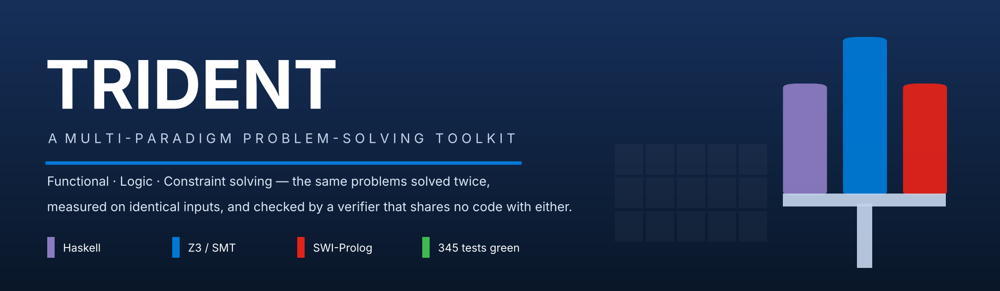

<br>

### Three paradigms. Four problems. One honest comparison.

**The same problems solved twice — in different paradigms — measured on identical inputs,<br>and checked by a verifier that shares no code with either.**

<br>

[](https://github.com/ebenjamin12/trident/actions/workflows/tests.yml)
[](#qa)
[](ruff.toml)
[](LICENSE)

[](task1-haskell-cryptography)
[](task3-tetravex)
[](task4-blocksworld/blocksworld/engines/z3_engine.py)
[](task4-blocksworld/blocksworld/prolog/blocksworld.pl)

<br>

### 📄 &nbsp;Read the full technical report

[](docs/Trident-Technical-Report.pdf)
[](docs/Trident-Technical-Report.docx)

<br>

**Elisha Benjamin Sreepalle**

[](https://ebenjamin12.github.io/)
[](https://www.linkedin.com/in/elishabenjaminsreepalle)
[](mailto:elishasreepalle@gmail.com)
[](https://github.com/ebenjamin12)

</div>

<br>

---

## 🔱 &nbsp;The one-sentence version

> When two solver paradigms can both attack a problem, **which one wins?**
> Trident measures it — and finds that the answer **reverses** between two problems
> attacked by the very same pair of engines. The shape of the problem decides,
> not the quality of the tool.

| Problem | Shape of the problem | Winner | Measured margin |
|---|---|:---:|---|
| **TetraVex** | One static constraint system | 🔵 **Z3 (SMT)** | `1.6×` at 4×4, rising to `7.6×` at 5×5 |
| **Blocks World** | Search for a sequence of unknown length | 🔴 **Prolog (IDA\*)** | `3.6×` – `15.8×` on engine time |

Same two solvers. Opposite outcomes. Demonstrating that **with numbers rather than
asserting it** is the entire point of this repository.

<br>

## 📋 &nbsp;Contents

<table>
<tr>
<td valign="top" width="50%">

- [Why this exists](#why)
- [Highlights](#highlights)
- [Architecture](#architecture)
- [Independent verification](#verification)
- [The four problem domains](#domains)
- [Benchmarks & results](#benchmarks)

</td>
<td valign="top" width="50%">

- [Engineering: CI & two instructive defects](#engineering)
- [Quality assurance](#qa)
- [Installation & usage](#install)
- [Known limitations](#limitations)
- [Roadmap — the fifth domain](#roadmap)
- [Tech stack & references](#stack)

</td>
</tr>
</table>

<br>

<a id="why"></a>

## 💡 &nbsp;Why this exists

It began as coursework for an MSc Advanced Programming module (7017SCN, Coventry
University), which asked for two problems implemented in Haskell and Z3. It satisfied
that brief — and then kept going, because the coursework could not answer the question
the work actually raised:

> **When two very different solver paradigms can both attack the same problem, which
> one actually wins — and is the answer a property of the tool, or of the problem?**

Answering that honestly takes more than two implementations. It needs identical inputs,
an arbiter of correctness that cannot be fooled by a bug shared with the solver, and
measurements that are *taken* rather than assumed. Trident supplies all three.

### Engineering objectives

| | Objective | What it means in practice |
|:---:|---|---|
| 🛡️ | **Independent verification** | No result is trusted because the thing that produced it says so |
| 🔁 | **Reproducibility** | Every instance is seeded; every benchmark records seeds, environment and raw measurements |
| 📏 | **Honest measurement** | Startup cost separated from solve time; medians with observed ranges; no cross-engine ratios where units differ |
| ⚖️ | **Comparison as the deliverable** | The paradigm comparison *is* the product, not an incidental benchmark |

<br>

<a id="highlights"></a>

## ✨ &nbsp;Highlights

<table>
<tr>
<td width="33%" valign="top">

### 🔀 Two solvers per problem
Both engines read **identical JSON instance files** and post the same constraints in
the same order — so the comparison is of *solvers*, not of two different models.

</td>
<td width="33%" valign="top">

### 🛡️ Verifier shares no code
Each domain's `verify.py` **imports no solver** and re-derives every rule from the
specification. Enforced by a test that parses its AST.

</td>
<td width="33%" valign="top">

### 🎯 Optimality with an argument
Admissible heuristic for IDA\*, incremental horizons for SAT planning — each with a
stated proof sketch, not a hope.

</td>
</tr>
<tr>
<td valign="top">

### 🚦 Three distinct statuses
`sat`, `unsat` (**proved**) and `limit` (gave up) are never conflated. Collapsing them
is the easiest way for a planner to lie.

</td>
<td valign="top">

### 🎨 Rich visualisation
ASCII, SVG, SVG filmstrip, SMIL-animated SVG (zero dependencies) and animated GIF.

</td>
<td valign="top">

### 🧪 345 automated tests
311 Python + 34 legacy, green on **both** the native and WebAssembly Prolog paths.

</td>
</tr>
</table>

<br>

<a id="architecture"></a>

## 🏗️ &nbsp;Architecture

The two newer domains share one layered structure. The arrows are the **only** permitted
import directions — and automated tests enforce the critical ones. This is a design rule
with a failing test behind it, not a diagram-level aspiration.

<div align="center">
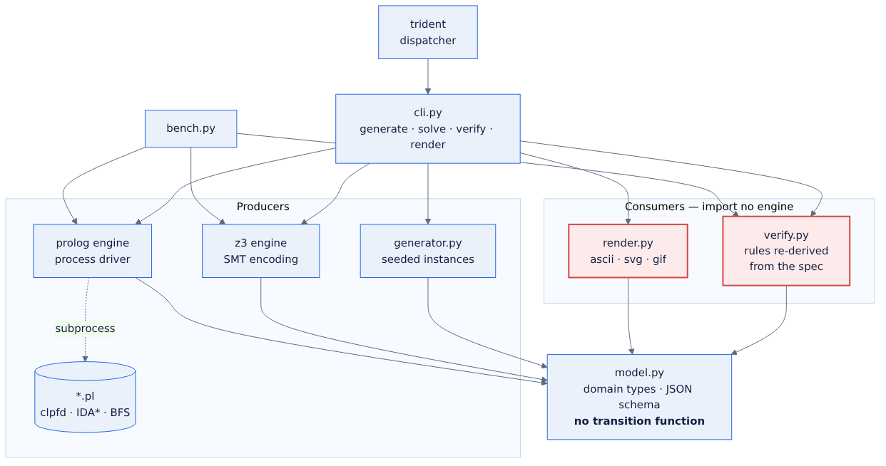
</div>

<blockquote>

### 🧬 The transition function is implemented **five times** on purpose

“Apply an action to a state” exists five separate times in Blocks World: in the Prolog
clauses, in the Z3 constraints, in the verifier, in a generator-local copy, and in the
BFS test oracle.

Consolidating them is the obvious refactor — and it would destroy the project's central
correctness argument. **If the verifier shared code with an engine, a bug in the shared
part would be invisible:** the engine would produce a wrong answer and the verifier would
cheerfully agree. Five independent derivations means a silent error has to be made five
times, in five notations, in the same way.

</blockquote>

<br>

<a id="verification"></a>

## 🛡️ &nbsp;Independent verification

Each newer domain ships a verifier that **imports no solver and reuses no engine's
transition code.** It re-derives every rule from the domain specification and reports
every violation it finds, with a step index:

```
INVALID - 1 violation(s) across 1 category/categories: action
  [action] step 2: block 'B' is not clear; 'C' rests on it
```

Three mechanisms keep that independence from decaying:

1. **A structural test** parses the verifier's AST and fails if any solver module appears among its imports.
2. **The CLI refuses to emit** a result that fails verification, whichever engine produced it — exit code `3`.
3. **Renderers refuse to draw** an unverified plan. A picture of an impossible plan is worse than no picture.

Evidence is also explicitly **ranked**, and the test suites are ordered to match. Two
engines agreeing with each other is the *weakest* signal available — both could share a
blind spot — so it is tested **last**.

<div align="center">
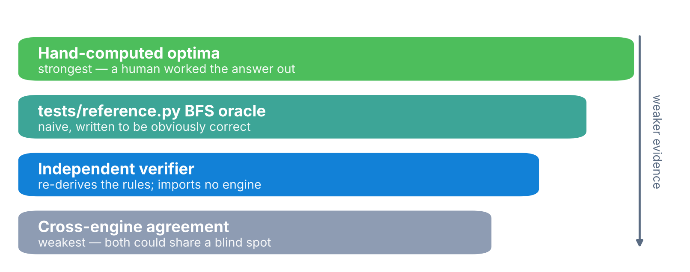
</div>

<br>

<a id="domains"></a>

## 🎲 &nbsp;The four problem domains

### 1️⃣ &nbsp;Cryptanalysis Toolkit — Haskell

   

Caesar and Vigenère ciphers with two **working attacks**: chi-squared frequency analysis
to recover an unknown Caesar key, and Kasiski examination to estimate a Vigenère key
length. Ciphers are pure transformations, decryption is encryption with a negated key,
and the key stream is an infinite lazy list — the functional idiom doing real work rather
than decorating an imperative algorithm.

<table>
<tr>
<td width="50%">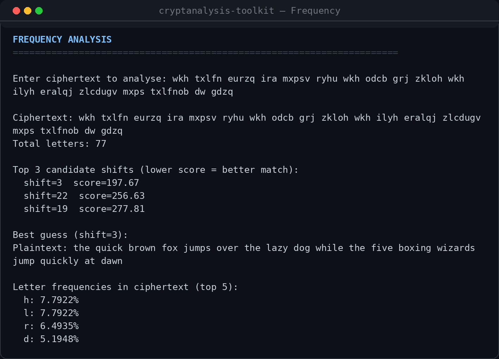</td>
<td width="50%">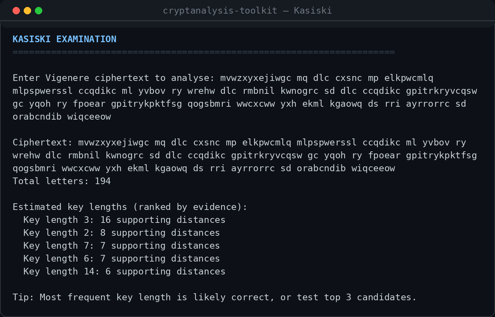</td>
</tr>
<tr>
<td align="center"><sub><b>Chi-squared frequency analysis</b> cracking a Caesar key</sub></td>
<td align="center"><sub><b>Kasiski examination</b> estimating a Vigenère key length</sub></td>
</tr>
</table>

<details>
<summary><b>More screenshots</b> — menu, ciphers and the built-in test suite</summary>
<br>
<table>
<tr>
<td width="50%">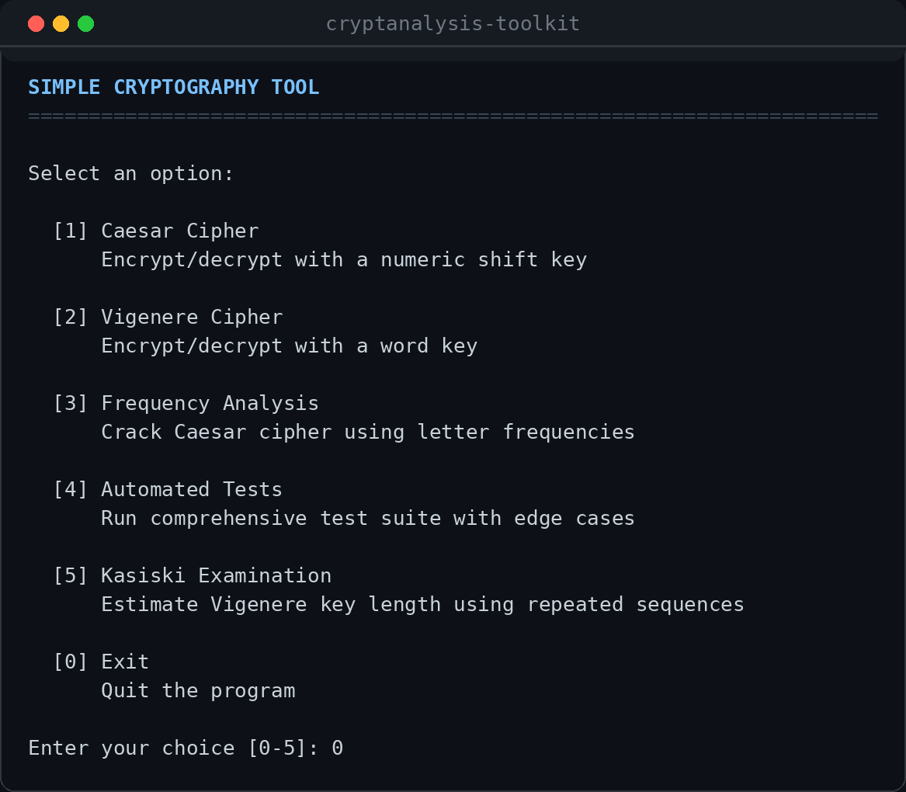</td>
<td width="50%">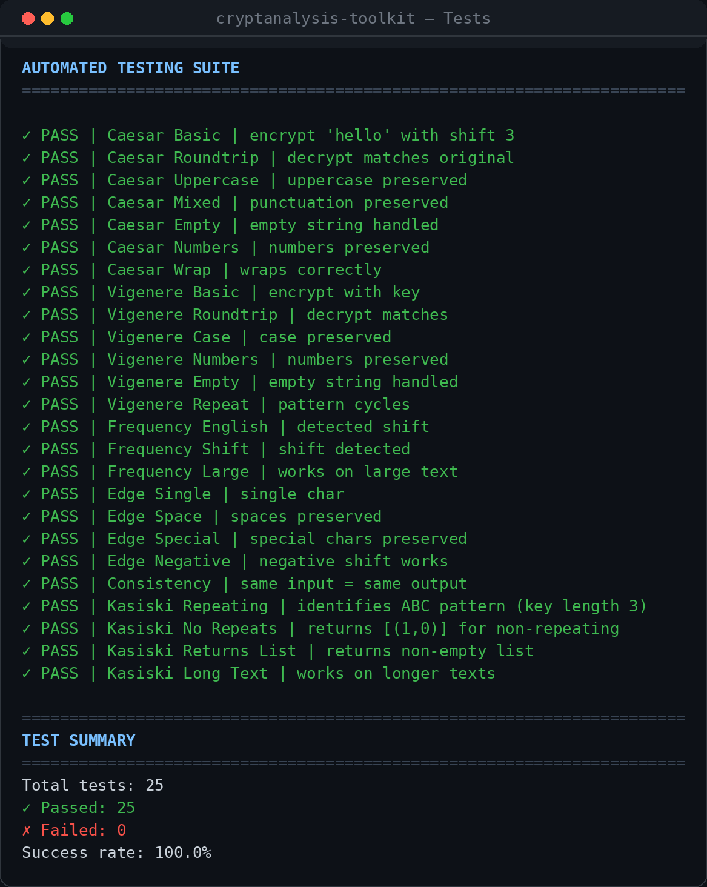</td>
</tr>
<tr>
<td align="center"><sub>Menu-driven interface</sub></td>
<td align="center"><sub>25-case built-in suite</sub></td>
</tr>
<tr>
<td width="50%">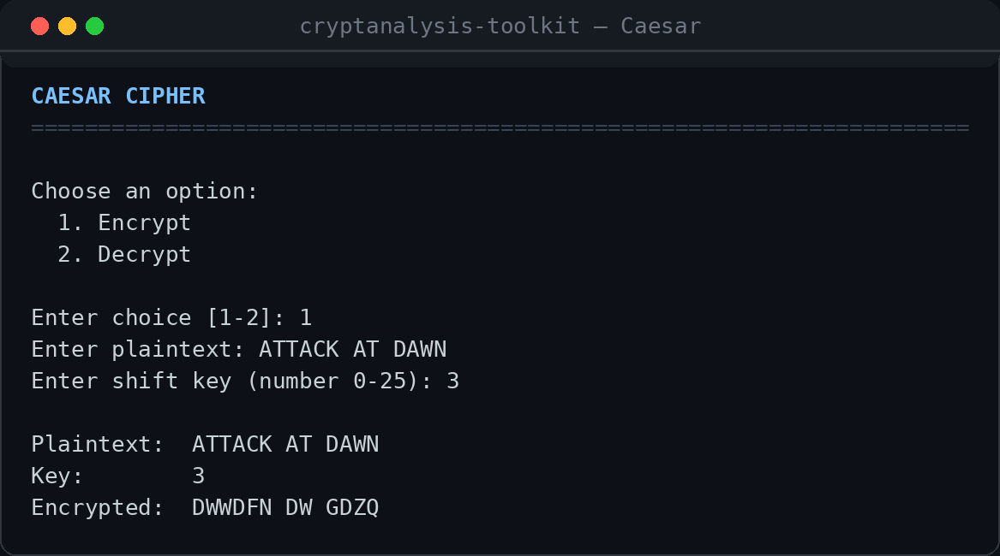</td>
<td width="50%">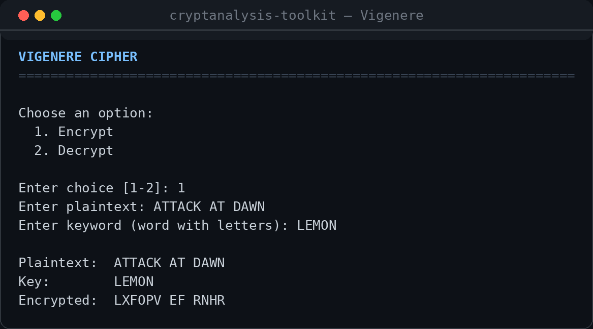</td>
</tr>
<tr>
<td align="center"><sub>Caesar cipher</sub></td>
<td align="center"><sub>Vigenère cipher</sub></td>
</tr>
</table>
</details>

```bash
cd task1-haskell-cryptography
runghc SimpleCryptography.hs          # or: cabal run
```

---

### 2️⃣ &nbsp;Cryptarithm Solver — Python + Z3

  

`SEND + MORE = MONEY` as a constraint problem, with a brute-force fallback that
**independently confirms** the SMT encoding. Both engines agreed on all nine test puzzles.

The measured speedup is the interesting part, because it is **not a constant**:

| Puzzle | Distinct letters | Z3 vs brute force |
|---|:---:|---|
| `SEND + MORE = MONEY` | 8 | 🟢 **350× faster** |
| `A + B = C` | 3 | 🔴 **0.02× — i.e. 50× slower** |

> Below a certain search-space size, **building** the constraint system costs more than
> simply checking a few hundred permutations. This is the same lesson the newer domains
> deliver at larger scale, and it is why this project reports **crossover points**
> rather than single headline multipliers.

<details>
<summary><b>Screenshots</b> — solver and benchmark harness</summary>
<br>
<table>
<tr>
<td width="50%">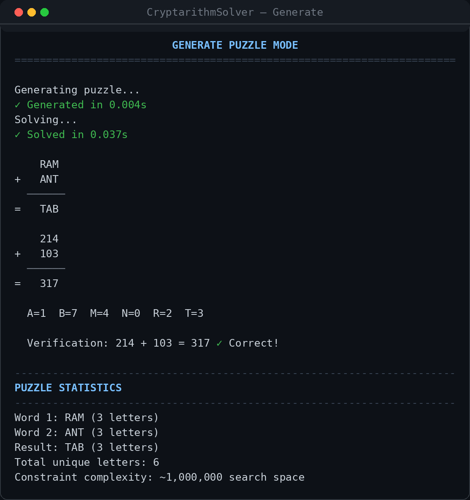</td>
<td width="50%">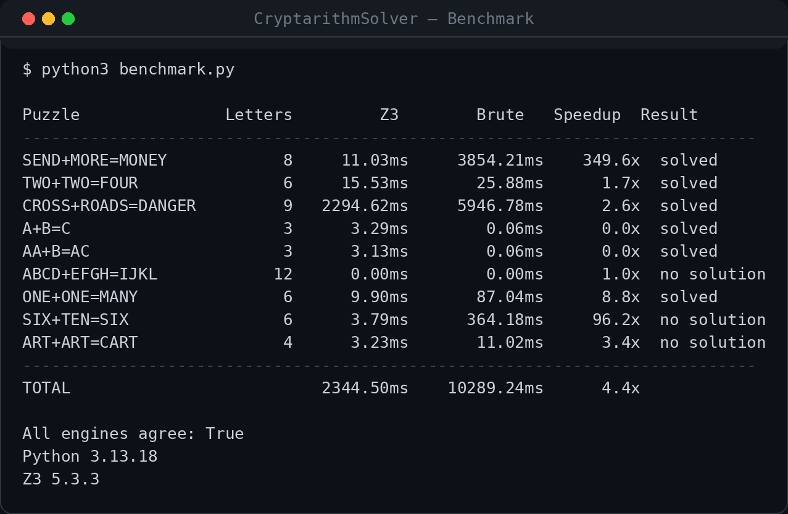</td>
</tr>
<tr>
<td align="center"><sub>Generating and solving a cryptarithm</sub></td>
<td align="center"><sub>Z3 vs brute-force benchmark</sub></td>
</tr>
</table>
</details>

---

### 3️⃣ &nbsp;TetraVex — Z3 **vs** Prolog CLP(FD)

   

Square tiles carrying a symbol on each edge must fill a grid so every pair of touching
sides matches. **Both engines post the same five constraints in the same order**, so the
comparison is genuinely of solvers rather than of two different models.

<table>
<tr>
<td width="50%" align="center">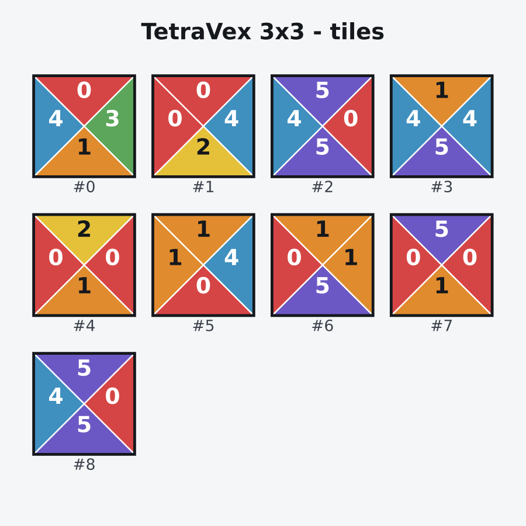</td>
<td width="50%" align="center">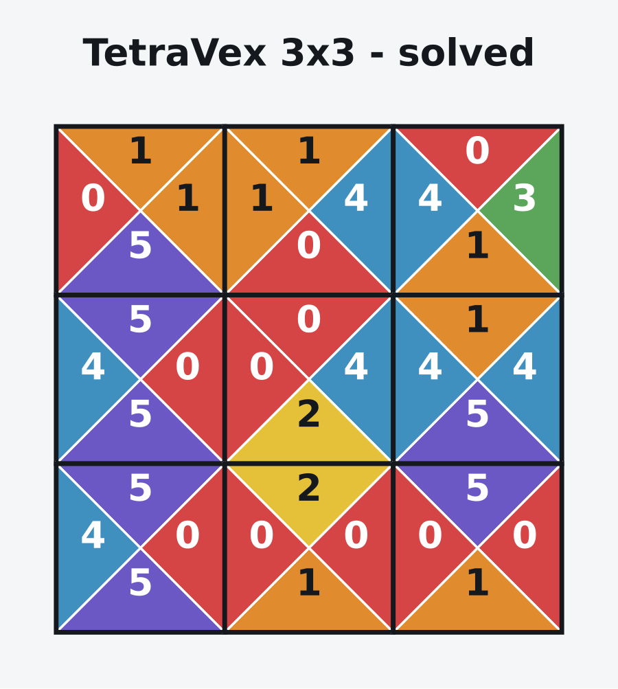</td>
</tr>
<tr>
<td align="center"><sub><b>Scrambled tile tray</b></sub></td>
<td align="center"><sub><b>Solved board</b> — every touching edge matches</sub></td>
</tr>
</table>

Supports **rotation** and a **pinned border** as variants, and answers whether a solution
is **unique** — Z3 by adding a blocking clause and re-solving, Prolog via `findall/3`
over `limit(2, …)`. Identical tiles are pinned into a fixed order first, so uniqueness
counts *pictures*, not labelled assignments.

📖 **Full documentation: [task3-tetravex/README.md](task3-tetravex/README.md)**

---

### 4️⃣ &nbsp;Blocks World — symbolic search **vs** planning-as-SAT

   

Rearrange stacks of blocks into a goal configuration in the **fewest moves**. Two
fundamentally different attacks on the same problem:

<table>
<tr>
<td width="50%" valign="top">

#### 🔴 Prolog — explicit search
Iterative deepening bounded by `f = g + h`, where `h` counts misplaced blocks.

**Admissibility:** a move changes the support of exactly one block, so it reduces `h`
by at most 1 — therefore `h` never exceeds the true distance, and the first solution
found is optimal.

</td>
<td width="50%" valign="top">

#### 🔵 Z3 — planning as satisfiability
Assert “there is a plan of exactly `T` steps”, starting at `T = 0` and incrementing.

Every step is forced to be a real move, so the **first satisfiable horizon *is* the
optimal plan length** — no post-hoc optimality check required.

</td>
</tr>
</table>

Both return the optimal three-move plan for the **Sussman anomaly**, the classic case
that defeats naive subgoal-ordering planners — a useful landmark precisely because the
*wrong* answer is a well-known one.

<div align="center">
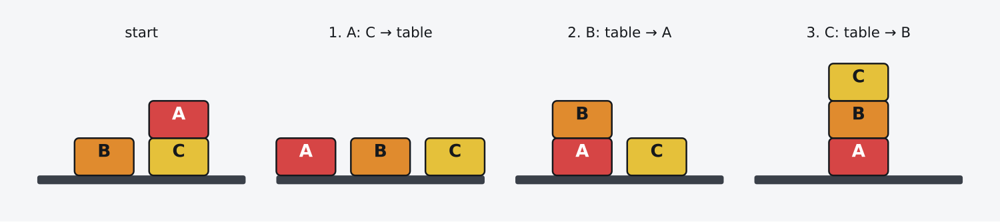
<br><sub><b>The Sussman anomaly, solved in three moves</b> — rendered directly by the toolkit</sub>
<br><br>
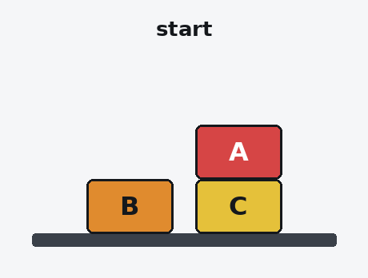
<br><sub>The same plan as an animated GIF (<code>./trident blocks render … --format gif</code>)</sub>
</div>

📖 **Full documentation: [task4-blocksworld/README.md](task4-blocksworld/README.md)**

<br>

<a id="benchmarks"></a>

## 📊 &nbsp;Benchmarks & results

> **Methodology first.** Both engines see identical seeded instances. Every result
> counted as a success is independently verified **before** it is counted. Startup cost
> is calibrated separately rather than subtracted. Medians are reported **with observed
> ranges**, so a long tail stays visible. Search-effort columns stay in each engine's own
> units — states expanded and horizons attempted are **never** converted into a ratio,
> because no honest conversion exists.

### TetraVex — Z3 wins, but not everywhere

<div align="center">
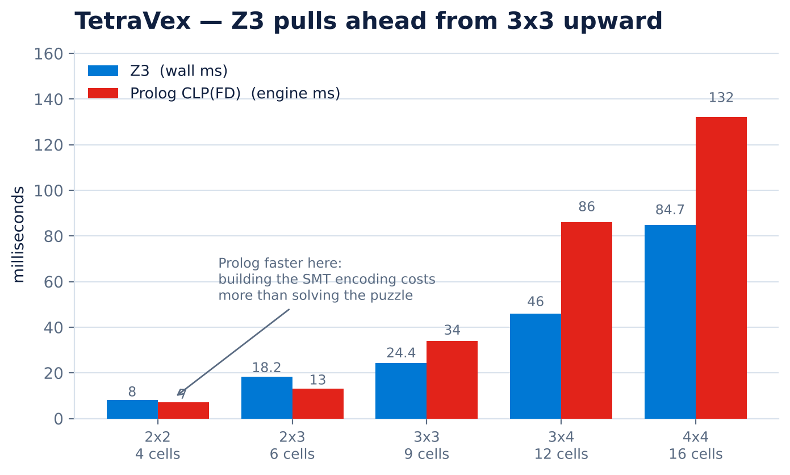
</div>

| Board | Cells | Z3 wall | Prolog engine | Ratio | Lengths agree | All verified |
|:---:|:---:|---:|---:|:---:|:---:|:---:|
| 2×2 | 4 | 8.0 ms | **7.0 ms** | `0.88×` 🔴 | ✅ | ✅ |
| 2×3 | 6 | 18.2 ms | **13.0 ms** | `0.71×` 🔴 | ✅ | ✅ |
| 3×3 | 9 | **24.4 ms** | 34.0 ms | `1.39×` 🔵 | ✅ | ✅ |
| 3×4 | 12 | **46.0 ms** | 86.0 ms | `1.87×` 🔵 | ✅ | ✅ |
| 4×4 | 16 | **84.7 ms** | 132.0 ms | `1.56×` 🔵 | ✅ | ✅ |

Prolog is genuinely **faster on the two smallest boards** — an SMT solver's constant cost
is real, and below it a lighter tool wins. Z3 pulls ahead from 3×3 upward and never gives
the lead back, widening to **7.6× at 5×5**.

<details>
<summary><b>Scaling to the wall</b> — both engines time out at the same place</summary>
<br>

<div align="center">
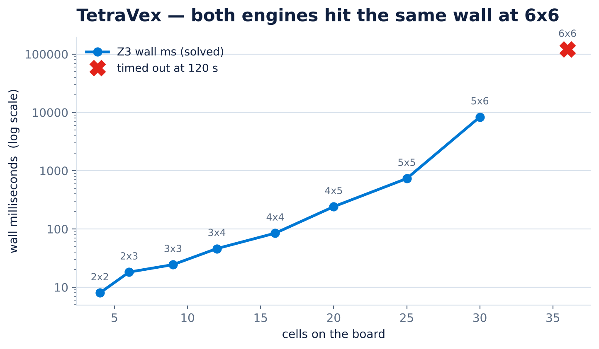
</div>

| Board | Cells | Z3 wall | Prolog engine | Ratio | Solved |
|:---:|:---:|---:|---:|:---:|:---:|
| 4×5 | 20 | 241.4 ms | 1 517.5 ms | `6.29×` | 4/4 |
| 5×5 | 25 | 733.3 ms | 5 599.0 ms | `7.64×` | 4/4 |
| 5×6 | 30 | 8 333.2 ms | 59 418.0 ms | `7.13×` | 4/4 |
| 6×6 | 36 | — | — | — | ⏱️ **0/2 — both time out at 120 s** |

A **shared ceiling**, not an engine-specific one.

</details>

### Blocks World — Prolog wins, decisively

<div align="center">
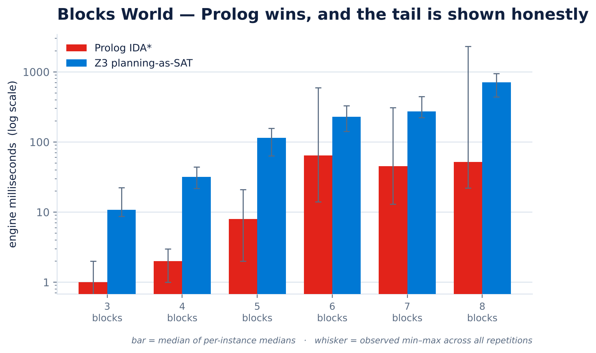
</div>

| Blocks | Optimal lengths | Prolog engine | Z3 engine | Ratio | Prolog states | Z3 horizons |
|:---:|:---:|---:|---:|:---:|:---:|:---:|
| 3 | 2, 3 | **1 ms** `[1–1]` | 11 ms `[9–20]` | `10.8×` | 5 | 4 |
| 4 | 4, 5 | **2 ms** `[2–2]` | 32 ms `[23–36]` | `15.8×` | 8 | 5 |
| 5 | 6, 7, 8 | **8 ms** `[2–16]` | 115 ms `[76–150]` | `14.4×` | 28 | 8 |
| 6 | 7, 9, 10 | **64 ms** `[15–559]` | 229 ms `[185–306]` | `3.6×` | 117 | 10 |
| 7 | 8, 9 | **45 ms** `[17–253]` | 273 ms `[252–418]` | `6.1×` | 95 | 10 |
| 8 | 9, 10, 12 | **52 ms** `[33–2223]` | 710 ms `[499–894]` | `13.7×` | 75 | 11 |

The engines agreed on plan length for **every instance tested**, and every plan passed
independent verification.

> ⚠️ **The honest caveat, kept in view.** Prolog's 8-block range is **33–2223 ms** — one
> seed cost **67× another**. Z3's spread is far tighter, which is its own kind of
> advantage: predictability. This is exactly why ranges are reported, not medians alone.

### 🔍 Why the answer reverses

To prove a 9-move plan optimal, Z3 must first prove horizons **0 through 8
unsatisfiable** — each a fresh and larger constraint system:

<div align="center">
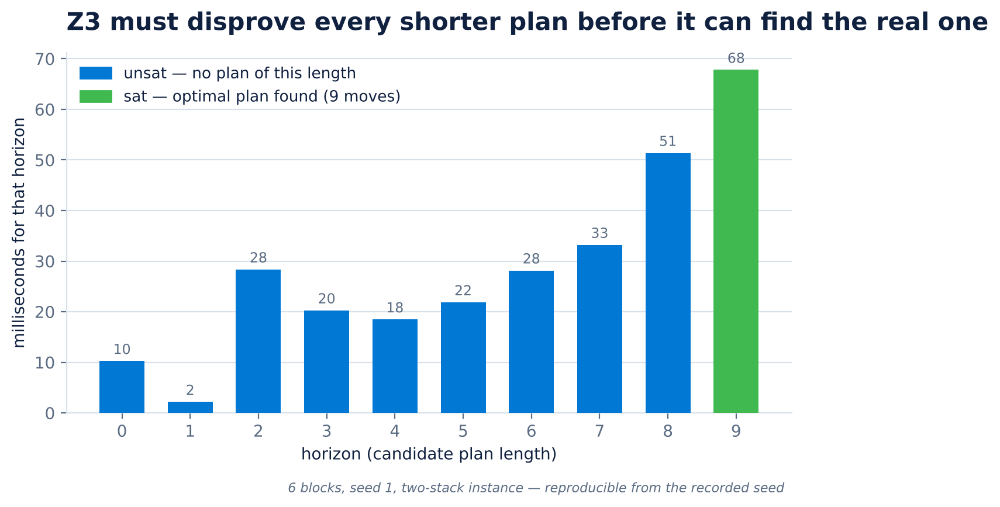
</div>

**Nine of the ten solver calls are spent proving that shorter plans do not exist.**
Prolog's IDA\* expands a few dozen states and stops.

TetraVex is a single constraint system with no notion of sequence — exactly SMT's home
ground. Blocks World is *sequential*, and asking “how long is the plan?” by trying every
length in turn makes the solver pay repeatedly for something explicit search answers once.

<details>
<summary><b>The asymmetry is starkest when no plan exists</b></summary>
<br>

<div align="center">
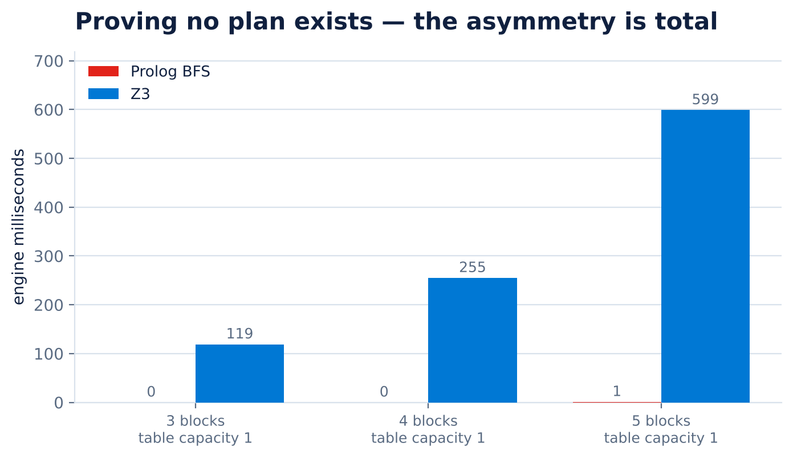
</div>

| Instance | Prolog BFS | Prolog IDA\* | Z3 | Verdict |
|---|---:|---:|---:|:---:|
| 3 blocks, table capacity 1 | **0 ms** | 1 ms | 119 ms | no plan |
| 4 blocks, table capacity 1 | **0 ms** | 1 ms | 255 ms | no plan |
| 5 blocks, table capacity 1 | **1 ms** | 1 ms | 599 ms | no plan |

> 🚦 **`limit` is not `unsat`.** An engine may report `unsat` only when it can *justify*
> it. “I searched to my ceiling and found nothing” is reported as `limit` — a third and
> distinct status. The distinction is enforced by tests.

</details>

📂 Raw data: [`task3-tetravex/bench/`](task3-tetravex/bench) · [`task4-blocksworld/bench/`](task4-blocksworld/bench)

<br>

<a id="engineering"></a>

## 🔧 &nbsp;Engineering: CI & two instructive defects

Seven CI jobs run on every push, deliberately split so a failure is **attributable on
sight** rather than requiring a bisect.

| CI job | What it proves | Status |
|---|---|:---:|
| `lint` | `ruff` across all project Python | ✅ |
| `python 3.10` → `3.13` | Both suites against a **native** SWI-Prolog (4 jobs) | ✅ |
| `swipl-wasm fallback` | Both suites with **no** native `swipl` on `PATH` | ✅ |
| `haskell` | task1 compiles clean under `-Wall`; 25-case suite runs | ✅ |

The native/WASM split matters: the Prolog engines prefer a native binary and fall back to
WebAssembly, and **only running both proves that both paths work.**

Bringing that matrix to green surfaced two defects worth recording in full — each
invisible to a *different* part of the safety net.

### 🐛 &nbsp;Defect #1 — the native Prolog path never received its arguments

| | |
|---|---|
| **Symptom** | `19 failed / 103 passed` in TetraVex on **all four** Python versions |
| **Exit signature** | `Prolog exited with code 1` — **empty stdout *and* empty stderr** |
| **Scope** | Every native Prolog call; the WASM path was unaffected |
| **Files changed** | 4 — two Python drivers, two Prolog sources |

**Root cause.** The driver invoked `swipl … tetravex.pl <facts> <mode>`. SWI-Prolog treats
that trailing `<facts>` path as a **second source file to consult**, not as an argument,
so it never reached the `argv` flag. The entry point matched `argv` against
`[File, ModeAtom|_]`, found only `[one]`, failed — and exited **silently**.

> ⚠️ **The subtlety that cost an extra debugging round.** The separator `--` must come
> **after** the model file. Placed *before* it, the model stops being consulted as a
> script, `main/0` becomes undefined, and SWI-Prolog silently resolves `main` against
> `library(main)`'s `main/1` instead — a *different* failure (exit 2) wearing identical
> clothes.

**The fix:**

```python
# driver — the separator goes after the model, before the data
cmd = [binary, "-q", "-g", "main", "-t", "halt",
       str(_MODEL), "--", str(facts), mode]
```

```prolog
% entry point — match the TAIL of argv, so it holds whether or not
% the binary's own name is included in the list
main :-
    current_prolog_flag(argv, Argv),
    append(_, [File, ModeAtom], Argv),
    run(File, ModeAtom, Json),
    write(Json), nl.
```

✅ **Outcome.** 311 tests now pass against **native SWI-Prolog 9.0.4** in CI — a path the
project had previously documented as *untested*, because no SWI-Prolog package was
available in the original development environment.

### 🐛 &nbsp;Defect #2 — a mode bit that broke every documented command

| | |
|---|---|
| **Symptom** | `./trident: Permission denied` — **exit 126**, all four Python versions |
| **When** | **After** all 311 tests passed; the very next step failed |
| **Root cause** | The dispatcher was committed with git mode **`100644`**, not `100755` |
| **Origin** | The bit is lost when a tree is rebuilt from an archive extracted on a filesystem with no Unix executable bit |

> 🚨 **Why the test suites could not catch this.** The tests import the packages directly
> and **never go through the dispatcher.** So all 311 tests pass while every one of the
> 13 commands documented in this README is broken for anyone who clones the repository.
> A green suite proved nothing about the user-facing entry point.

**The fix** changes no file contents — only the mode recorded in the git index, which is
why it works even where the filesystem cannot represent the bit:

```bash
git update-index --chmod=+x trident
```

The tempting workaround — invoking the dispatcher through the interpreter in CI — was
**rejected**: it would have turned CI green while leaving every user broken.

> ### 🎓 The transferable lesson
> Both defects were invisible to a passing test suite, in **opposite** ways: the first
> because a failure path produced **no diagnostic output at all**, the second because the
> tests exercised a **different entry point than users do**.
>
> **A green test suite describes what is tested — never what is shipped.**

<br>

<a id="qa"></a>

## ✅ &nbsp;Quality assurance

<div align="center">

| | | | |
|:---:|:---:|:---:|:---:|
| **122** | **189** | **34** | **0** |
| TetraVex tests | Blocks World tests | Haskell + Z3 legacy | lint findings |

</div>

```bash
ruff check .
(cd task3-tetravex    && python -m pytest tests/ -q)
(cd task4-blocksworld && python -m pytest tests/ -q)
```

| Suite | Result | Runtime |
|---|---|---:|
| `ruff check .` | ✅ All checks passed | — |
| `task3-tetravex` | ✅ **122 passed**, 0 skipped | ~25 s |
| `task4-blocksworld` | ✅ **189 passed**, 0 skipped | ~23 s |
| task1 Haskell suite | ✅ 25 cases, 0 failed | — |
| task2 solver suite | ✅ 9 cases, both engines agree | — |

> Solver tests **skip rather than fail** when a toolchain is absent, so a run reporting
> skips means your environment is incomplete — *not* that the code is sound. Both suites
> run with **zero skips** in CI, on both the native and WebAssembly Prolog paths.

### Strongest evidence first

The test suites are deliberately ordered by evidential strength: engine output is checked
against **hand-computed optima** first, then against
[`tests/reference.py`](task4-blocksworld/tests/reference.py) — a deliberately naive BFS
oracle written to be obviously correct — and **cross-engine agreement comes last**.

<br>

<a id="install"></a>

## ⚙️ &nbsp;Installation & usage

### Requirements

| Component | Requirement | Notes |
|---|---|---|
| Python | 3.10 + | Tested on 3.10, 3.11, 3.12, 3.13 |
| Z3 | `z3-solver` | Installed via `requirements.txt` |
| Prolog | `swipl` on `PATH` **or** Node ≥ 18 | Native preferred; `swipl-wasm` fallback is automatic |
| Haskell | GHC 9.4 | task1 only |
| Pillow | optional | GIF rendering only |

### Setup

```bash
git clone https://github.com/ebenjamin12/trident.git
cd trident

pip install -r task3-tetravex/requirements.txt
pip install -r task4-blocksworld/requirements.txt

# Prolog: either install SWI-Prolog natively (preferred) …
sudo apt-get install swi-prolog-nox

# … or use the zero-install WebAssembly fallback
npm ci --prefix task3-tetravex/tetravex/prolog
npm ci --prefix task4-blocksworld/blocksworld/prolog
```

### Check which engines are available

```bash
./trident blocks engines
./trident tetravex engines
```

```
z3       available   Z3 5.3.3
prolog   available   SWI-Prolog version 9.0.4 for x86_64-linux (native)  [mode: native]
```

### Blocks World

```bash
./trident blocks generate --blocks 8 --seed 42 --max-stacks 2 -o problem.json
./trident blocks solve problem.json --engine prolog --explain -o plan.json
./trident blocks solve problem.json --engine z3                -o plan-z3.json
./trident blocks verify problem.json plan.json
./trident blocks render problem.json --solution plan.json --format gif -o plan.gif
```

### TetraVex

```bash
./trident tetravex generate --rows 4 --cols 4 --seed 7 -o puzzle.json
./trident tetravex solve puzzle.json --engine z3     --unique -o sol.json
./trident tetravex solve puzzle.json --engine prolog --unique -o sol-pl.json
./trident tetravex verify puzzle.json sol.json
```

### Exit codes

| Code | Meaning |
|:---:|---|
| `0` | Success — and **verified** |
| `1` | Usage or input error |
| `2` | No solution within the given bound |
| `3` | 🚨 **Verification failed** — the result was *not* emitted |

<br>

<a id="structure"></a>

## 📁 &nbsp;Repository structure

```
trident/
├── trident                        # unified CLI dispatcher  (git mode 100755)
├── task1-haskell-cryptography/    # Haskell — ciphers & cryptanalysis
├── task2-cryptarithm-z3/          # Python + Z3 — cryptarithms
├── task3-tetravex/                # TetraVex — Z3 vs Prolog CLP(FD)
│   ├── tetravex/
│   │   ├── model.py               # domain types · JSON schema
│   │   ├── generator.py           # seeded instances
│   │   ├── verify.py              # ← imports no solver
│   │   ├── render.py              # ascii · svg
│   │   ├── solvers/               # z3_solver.py · prolog_solver.py
│   │   └── prolog/tetravex.pl     # CLP(FD) model
│   ├── bench/                     # recorded benchmark data
│   └── tests/                     # 122 tests
├── task4-blocksworld/             # Blocks World — Prolog search vs Z3 SAT
│   ├── blocksworld/
│   │   ├── model.py               # ← deliberately NO transition function
│   │   ├── verify.py              # ← imports no engine
│   │   ├── render.py              # ascii · svg · filmstrip · animated · gif
│   │   ├── engines/               # z3_engine.py · prolog_engine.py
│   │   └── prolog/blocksworld.pl  # IDA* · IDDFS · BFS
│   ├── bench/                     # recorded benchmark data
│   └── tests/                     # 189 tests + reference.py oracle
├── docs/                          # technical report (PDF + DOCX) & figures
└── .github/workflows/tests.yml    # 7-job CI matrix
```

<br>

<a id="limitations"></a>

## ⚠️ &nbsp;Known limitations

Stated plainly, because a comparative study that hides its weak points is not evidence
of anything.

| # | Limitation |
|:---:|---|
| 1 | **Published Prolog timings were measured through `swipl-wasm`.** The native path is now fully tested in CI, but the benchmark figures above predate that and have not been re-measured natively. |
| 2 | **Small samples** — 3 seeds × 3 repetitions. Medians and ranges are reported; no confidence intervals, because quoting one from three samples would be noise. |
| 3 | **Short plans only** (≤ 12 moves). The literature finds SAT planning competitive at much longer horizons; nothing measured here contradicts that. |
| 4 | **Blocks World goals must be complete configurations.** Partial goals (`on(A,B)` with the rest unconstrained) are not supported. |
| 5 | **No sound unsolvability bound on a restricted table.** Where `table_capacity < n_blocks` the `2n` argument fails, so only `bfs` settles it — and only while the state space fits in memory. |
| 6 | **TetraVex uniqueness ignores rotational duplicates** under `--rotation`. |
| 7 | **`bfs` uses list-based closed and frontier sets**, so membership is linear. Adequate for small unsolvability proofs; not a general-purpose BFS. |
| 8 | **Preserved coursework is deliberately not modified** — the published figures were measured against exactly that code. Known defects are documented rather than fixed. |

<br>

<a id="roadmap"></a>

## 🚀 &nbsp;Roadmap — the fifth domain

> The original assessment brief listed **five** problems. Trident implements four.
> **Cellular Automata simulation is the one not yet built** — and it is the most
> interesting remaining candidate, not because it is difficult to simulate, but because
> of what happens when the question is **turned around**.

<div align="center">
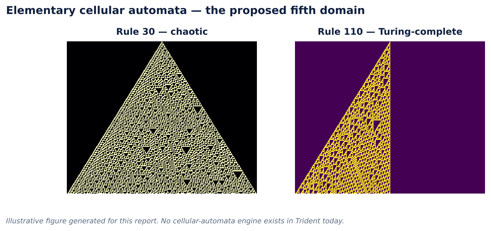
</div>

### Why it fits the comparison, rather than merely extending the table

Forward simulation of a cellular automaton is trivial in every paradigm and would prove
nothing. The **inverse** problem is the valuable one:

> ### 🧩 The pre-image problem
> Given a target configuration at generation *t*, does a configuration at *t−1* exist
> that produces it — and is it **unique**? Some states have many predecessors, and some
> have **none at all** (the *“Garden of Eden”* states).
>
> That is a genuine constraint satisfaction problem, **not** a simulation.

This framing maps directly onto the comparison the project already makes — and it would
**test** the central thesis rather than merely illustrate it:

| Question | Shape | Predicted winner | Why |
|---|---|:---:|---|
| Does a predecessor exist? | One static constraint system | 🔵 **Z3** | Same shape as TetraVex — no notion of sequence |
| Shortest path to a target state | Sequential search, unknown length | 🔴 **Prolog** | Same shape as Blocks World — horizon iteration is costly |

**A prediction that can be checked is worth far more than another benchmark row.** If Z3
wins the pre-image problem and Prolog wins shortest-path, the thesis survives a genuine
test on a domain it was not derived from. If not, the thesis needs revising — which is
just as useful a result.

<details>
<summary><b>The scaffolding is already shaped for it</b></summary>
<br>

| Module | What it would need |
|---|---|
| `model.py` | A configuration is a **bit vector**; a rule is an integer 0–255. Simpler than either existing domain. |
| `generator.py` | Seeded random configurations, with rule and width as difficulty controls. |
| `verify.py` | **Unusually strong here.** To check a claimed predecessor, simply *simulate it forward one step* and compare. The verification method is utterly unlike the solving method — exactly the independence this project demands everywhere else. |
| `render.py` | A spacetime diagram is a pixel grid; the existing SVG and GIF renderers transfer almost directly. |
| `bench.py` | The harness is domain-agnostic and needs only a new suite definition. |

</details>

### Also on the roadmap

- **Partial goals in Blocks World** — the single change that most expands what the domain can express. Partial goals *lengthen* optimal plans, which is precisely the regime where SAT planning is reported to become competitive.
- **Native-Prolog benchmark figures**, replacing the WebAssembly wall-clock numbers now that the native path is verified in CI.
- **A third engine per problem** — a hand-written backtracking solver as a control that is neither SMT nor CLP(FD).
- **CLP(FD) labelling strategies** (`ff`, `ffc`, `min`) compared on a fixed model, isolating search heuristics from modelling.

<br>

<a id="stack"></a>

## 🛠️ &nbsp;Tech stack

| Paradigm | Technology | Where it is used |
|---|---|---|
| Functional | **Haskell** — GHC 9.4, `base` only | task1 — ciphers as pure transformations |
| SMT / declarative constraints | **Z3 5.3.3** via `z3-solver` | task2, task3, task4 |
| Constraint logic programming | **SWI-Prolog 9.0.4**, `library(clpfd)` | task3 — TetraVex model |
| Symbolic state-space search | **SWI-Prolog** — IDA\*, IDDFS, BFS | task4 — Blocks World planner |
| Portable fallback | **swipl-wasm 3.8.2** under Node | Both Prolog engines, when no native binary exists |
| Imperative baseline | **Python** brute force | task2 — control for the SMT encoding |
| Tooling | **pytest · ruff · GitHub Actions · Pillow** | Tests, lint, CI, GIF rendering |

<br>

<a id="references"></a>

## 📚 &nbsp;References

<details>
<summary><b>Solvers and constraint technology</b></summary>
<br>

- de Moura, L. & Bjørner, N. (2008). Z3: An Efficient SMT Solver. *TACAS 2008*, LNCS 4963, 337–340.
- Wielemaker, J., Schrijvers, T., Triska, M. & Lager, T. (2012). SWI-Prolog. *Theory and Practice of Logic Programming*, 12(1–2), 67–96.
- Régin, J.-C. (1994). A Filtering Algorithm for Constraints of Difference in CSPs. *AAAI-94*, 362–367. — the algorithm behind `all_distinct/1`.
- Triska, M. (2016). The Boolean Constraint Solver of SWI-Prolog. *FLOPS 2016*, LNCS 9613, 45–61.
- Tsang, E. (1993). *Foundations of Constraint Satisfaction*. Academic Press.

</details>

<details>
<summary><b>Search and planning</b></summary>
<br>

- Korf, R. E. (1985). Depth-first iterative-deepening: An optimal admissible tree search. *Artificial Intelligence*, 27(1), 97–109.
- Hart, P. E., Nilsson, N. J. & Raphael, B. (1968). A Formal Basis for the Heuristic Determination of Minimum Cost Paths. *IEEE Transactions on Systems Science and Cybernetics*, 4(2), 100–107. — the admissibility result IDA\* optimality rests on.
- Kautz, H. & Selman, B. (1992). Planning as Satisfiability. *ECAI-92*.
- Rintanen, J., Heljanko, K. & Niemelä, I. (2006). Planning as satisfiability: parallel plans and algorithms for plan search. *Artificial Intelligence*, 170(12–13), 1031–1080.
- Fikes, R. E. & Nilsson, N. J. (1971). STRIPS: A new approach to the application of theorem proving to problem solving. *Artificial Intelligence*, 2(3–4), 189–208.

</details>

<details>
<summary><b>Problem domains</b></summary>
<br>

- Takenaga, Y. & Walsh, T. (2006). Tetravex is NP-complete. *Information Processing Letters*, 99, 171–174.
- Gupta, N. & Nau, D. S. (1992). On the complexity of blocks-world planning. *Artificial Intelligence*, 56, 223–254.
- Sussman, G. J. (1975). *A Computer Model of Skill Acquisition*. — the Sussman anomaly.
- Wolfram, S. (2002). *A New Kind of Science*. Wolfram Media. — elementary cellular automata rule space.
- Cook, M. (2004). Universality in Elementary Cellular Automata. *Complex Systems*, 15(1), 1–40. — Rule 110.

</details>

<details>
<summary><b>Cryptography</b></summary>
<br>

- Kahn, D. (1967). *The Codebreakers*. Macmillan.
- Menezes, A., van Oorschot, P. & Vanstone, S. (1997). *Handbook of Applied Cryptography*. CRC Press.
- Stallings, W. (2017). *Cryptography and Network Security: Principles and Practice* (7th ed.). Pearson.
- Singh, S. (1999). *The Code Book*. Fourth Estate.

</details>

<br>

<a id="contributing"></a>

## 🤝 &nbsp;Contributing

Trident is a comparative study, which shapes what a useful contribution looks like.
Six rules are **not stylistic** — breaking them silently invalidates the project's
results. See **[CONTRIBUTING.md](CONTRIBUTING.md)** before opening a pull request.

<br>

---

<div align="center">

## 👤 &nbsp;Author

### Elisha Benjamin Sreepalle

*MSc Computer Science · Coventry University*

[](https://ebenjamin12.github.io/)
[](https://www.linkedin.com/in/elishabenjaminsreepalle)
[](mailto:elishasreepalle@gmail.com)
[](https://github.com/ebenjamin12)

<br>

### 📄 Read the full write-up

[](docs/Trident-Technical-Report.pdf)
[](docs/Trident-Technical-Report.docx)

<br>

**Licensed under [MIT](LICENSE)** — use it, learn from it, build on it.

<sub>If this project was useful or interesting, a ⭐ is always appreciated.</sub>

</div>
